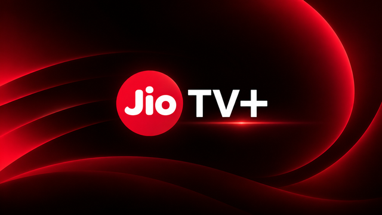

# 📺 JioTV+ for Android TV & Fire TV

<p align="center">
  
</p>

<p align="center">
  <strong>A premium, modern 10-Foot Live Television experience engineered specifically for Android TV, Google TV, and Amazon Fire TV Stick.</strong>
</p>

<p align="center">
  <a href="https://github.com"></a>
  <a href="https://flutter.dev"></a>
  <a href="https://kotlinlang.org"></a>
  <a href="#-how-to-download--install-apk-from-releases"></a>
  <a href="LICENSE"></a>
</p>

---

## 📌 Table of Contents

- [✨ Key Features](#-key-features)
  - [📺 1,000+ Live Channels](#-1000-live-channels-in-hd--4k)
  - [🧭 2D EPG Timeline Guide](#-2d-epg-electronic-program-guide)
  - [⏪ 7-Day Catch-Up TV](#-7-day-catch-up-tv)
  - [🔥 Amazon Fire TV & Android TV "Live TV" (TIF) Integration](#-amazon-fire-tv--android-tv-live-tv-tif-integration)
  - [⚡ Built-in DRM & Local Stream Proxy](#-built-in-local-drm--hls-stream-proxy)
  - [🎬 Advanced Video Player (OSD)](#-advanced-video-player-osd)
  - [🎮 10-Foot TV Remote Navigation](#-10-foot-remote-friendly-navigation)
- [📥 How to Download & Install APK from Releases](#-how-to-download--install-apk-from-releases)
  - [Method 1: Using the "Downloader" App (Recommended for Fire TV / Google TV)](#method-1-using-the-downloader-app-recommended-for-fire-tv--google-tv)
  - [Method 2: Using "Send Files to TV" (SFTV) from Phone or PC](#method-2-using-send-files-to-tv-sftv-from-phone-or-pc)
  - [Method 3: Using a USB Pen Drive](#method-3-using-a-usb-pen-drive)
  - [Method 4: Using ADB (For Power Users & Developers)](#method-4-using-adb-for-power-users--developers)
- [📡 Setup Amazon Fire TV Native Live TV Guide](#-setup-amazon-fire-tv-native-live-tv-guide)
- [🎮 TV Remote Control Shortcuts](#-tv-remote-control-shortcuts)
- [🛠️ Build from Source (For Developers)](#️-build-from-source-for-developers)
- [❓ Frequently Asked Questions (FAQ)](#-frequently-asked-questions-faq)
- [⚖️ Legal Disclaimer](#-legal-disclaimer)

---

## ✨ Key Features

### 📺 1,000+ Live Channels in HD & 4K
- Stream **1,000+ linear TV channels** across high-definition (HD) and ultra-high-definition (4K) qualities.
- **Categorized by Genres**: Entertainment, Sports, News, Movies, Kids, Music, Infotainment, Devotional, Lifestyle, and Regional.
- **15+ Indian Languages Supported**: Hindi, English, Tamil, Telugu, Kannada, Malayalam, Bengali, Marathi, Gujarati, Punjabi, Odia, Bhojpuri, Assamese, and Urdu.
- **Channel Favorites**: Save favorite channels with a single remote click and filter them instantly anytime.

### 🧭 2D EPG (Electronic Program Guide)
- **Synchronized 2D Timeline Grid**: Browse scheduled programming across a 24-hour horizontal timeline with vertical channel rails.
- **Real-Time Indicators**: Dynamic "Live" pulsing markers, program start/end time indicators, and percentage watched.
- **Detailed Program Synopsis**: View episode titles, descriptions, genres, language, and content advisories directly from the grid.

### ⏪ 7-Day Catch-Up TV
- Never miss a cricket match, news bulletin, or daily soap episode again!
- Browse past broadcasts by date (up to **7 days backwards**) and channel.
- Jump directly into any previous broadcast with instant playback and timeline scrubbing.

### 🔥 Amazon Fire TV & Android TV "Live TV" (TIF) Integration
- **Native System Integration**: Powered by Android's **TV Input Framework (TIF)** and Amazon Fire TV extensions.
- **Live Guide Sync**: Channels automatically appear directly in Amazon Fire TV's native **"Live"** tab and Channel Guide under **Settings > Live TV > Sync Sources > JioTV+**.
- **System Deep Linking**: Click any channel in your TV's system guide or "On Now" recommendation row to launch the stream directly in the player.
- **Background EPG Sync**: WorkManager background service continuously fetches updated schedules.

### ⚡ Built-in Local DRM & HLS Stream Proxy
- **Zero 403 Forbidden / CORS Errors**: Contains a lightweight, embedded HTTP proxy running on `127.0.0.1`.
- Automatically signs and rewrites AES-128 `#EXT-X-KEY` DRM requests with required security headers (`ssotoken`, `channelId`, `srno`).
- Handles Akamai CDN `__hdnea__` tokens and `.ts` chunk streaming seamlessly with hardware-accelerated ExoPlayer.

### 🎬 Advanced Video Player (OSD)
- **Quality Selector**: Auto (Adaptive 1080p), 1080p Full HD, 720p HD, and 480p Low Data.
- **Audio & Subtitle Picker**: Switch multi-language audio commentary (e.g., Hindi, English, Tamil, Telugu for sports) and subtitles on the fly.
- **Aspect Ratio Control**: Switch between **Original (Fit)** and **16:9 Stretched/Zoomed (Fill)**.
- **Channel Zapping Drawer**: Browse similar channels or swipe through the channel lineup without stopping playback.
- **Quick Mini-Guide**: Inspect upcoming programs for the current channel right from the playback overlay.

### 🎮 10-Foot Remote-Friendly Navigation
- **Designed Purely for D-Pad Remotes**: No clumsy air-mouse or touch emulator required. Every element features glowing TV focus states, contrast rings, and elevation animations.
- **Direct Number Key Support**: Jump directly to channel numbers (e.g., press `1`, `4`, `4` on your remote to jump to Channel 144).
- **Color Button Shortcuts**: Quick shortcuts mapped to TV remote Red, Green, Yellow, and Blue keys.
- **TV Mobile Login**: Convenient on-screen 3x4 dial-pad with D-pad control and physical 0-9 support for mobile OTP login, plus an "Explore as Guest" option.

---

## 📥 How to Download & Install APK from Releases

Follow the simple instructions below to download the latest APK directly to your TV.

> [!TIP]
> **Where to find the APK on GitHub:**
> 1. On this GitHub repository page, look at the right sidebar and click on **[Releases](../../releases)** (or navigate to the Releases tab).
> 2. Under the **Latest Release**, expand the **Assets** section (click on `Assets` if collapsed).
> 3. Click on **`app-release.apk`** to download it.

---

### Method 1: Using the "Downloader" App (Recommended for Fire TV / Google TV)

The **Downloader by AFTVnews** app is the easiest and most popular way to install apps directly onto your Fire TV Stick, Google TV, or Android TV.

#### Step 1: Install the "Downloader" App
1. On your TV home screen, open the **Search** / **App Store** (Amazon Appstore on Fire TV, Google Play Store on Android TV / Google TV).
2. Search for **`Downloader`** (orange icon by AFTVnews) and click **Install / Get**.

#### Step 2: Enable "Install Unknown Apps"
1. Go to your TV **Settings**:
   - **On Fire TV:** Go to `Settings > My Fire TV > Developer Options > Install unknown apps > Downloader > Turn ON`.
     *(Note: If "Developer Options" is hidden, go to `Settings > My Fire TV > About`, highlight your device name, and press the **OK/Select** button **7 times** until you see "You are now a developer").*
   - **On Android TV / Google TV:** Go to `Settings > Apps > Special app access > Install unknown apps > Downloader > Enable`.
     *(Note: If needed, enable Developer Options via `Settings > System > About > Android TV OS build` by pressing **OK** 7 times).*

#### Step 3: Download & Install via Downloader
1. Open the **Downloader** app on your TV and grant storage permission.
2. In the URL / Search box, type the direct link to the release APK:
   ```text
   https://github.com/<YOUR_GITHUB_USERNAME>/<REPO_NAME>/releases/latest/download/app-release.apk
   ```
   *(You can also use a URL shortener like `tinyurl.com` or an AFTVnews shortcode for quick typing).*
3. Click **Go**. Downloader will automatically fetch the APK.
4. Once downloaded, a prompt will appear: select **Install**.
5. After installation completes, select **Open** to launch JioTV+!

---

### Method 2: Using "Send Files to TV" (SFTV) from Phone or PC

If you have already downloaded `app-release.apk` onto your smartphone or laptop:

1. Install **Send Files to TV (SFTV)** on both your TV and your Android phone from the Google Play Store.
2. Install a file manager on your TV (such as **CX File Explorer**, **X-plore**, or **AnExplorer**).
3. Connect both devices to the same Wi-Fi network.
4. Open **SFTV** on your phone, choose **Send**, and pick `app-release.apk`.
5. Open **SFTV** on your TV, choose **Receive**. The file will transfer in seconds.
6. Open your TV file manager, navigate to the `Download` folder, select `app-release.apk`, and click **Install**.

---

### Method 3: Using a USB Pen Drive

For Smart TVs and TV boxes with a USB port (e.g., Mi TV, Sony Bravia, OnePlus TV, Nvidia Shield):

1. Download **`app-release.apk`** from [GitHub Releases](../../releases) onto your PC or Mac.
2. Copy the APK file to a FAT32-formatted USB flash drive.
3. Plug the USB flash drive into your TV's USB port.
4. Open any File Manager app on your TV, browse to your USB drive, select `app-release.apk`, and install it.

---

### Method 4: Using ADB (For Power Users & Developers)

If you have ADB configured on your PC and ADB Debugging turned on in your TV's Developer Options:

```bash
# 1. Connect to your TV via its local IP address (found in TV Network Settings)
adb connect 192.168.1.xxx:5555

# 2. Install the APK
adb install -r app-release.apk

# 3. Launch the app directly (optional)
adb shell monkey -p com.jio.tvplus.jio_tv_plus_flutter -c android.intent.category.LEANBACK_LAUNCHER 1
```

---

## 📡 Setup Amazon Fire TV Native Live TV Guide

JioTV+ integrates with the native Fire TV Channel Guide so you can browse channels directly from the Fire OS system interface:

```
Fire TV Home Screen
  └── ⚙️ Settings
        └── 📺 Live TV
              └── 🔄 Sync Sources
                    └── JioTV+ (Click "Sync Channels")
```

1. Open **Settings** on your Amazon Fire TV.
2. Select **Live TV**.
3. Select **Sync Sources**.
4. You will see **JioTV+** listed as an available live TV source.
5. Click **JioTV+** and select **Sync Channels**.
6. Once synced, press the **Guide / Live** button on your Fire TV remote (or navigate to the **Live** tab on your Fire TV Home screen) to enjoy native channel browsing with real-time EPG!

---

## 🎮 TV Remote Control Shortcuts

The application is built around standard 5-way D-Pad TV remotes and supports hardware remote buttons:

| Button | Action in Player / Screens |
| :--- | :--- |
| **D-Pad Up / Down** | In Player: Open Quick Channel Switcher / Zap channels. In Grids: Move focus between rows. |
| **D-Pad Left / Right** | In Player: Seek backward/forward or navigate player controls. In Guide: Scroll timeline. |
| **Select / OK / Center** | Play/Pause stream, confirm selection, toggle player On-Screen Display (OSD). |
| **Back / Escape** | Close player, dismiss dialogs, or return to Home Live Guide. |
| **0 – 9 (Number Keys)** | Direct channel number dialing (jump instantly to any channel number). |
| **🔴 Red Key (F1)** | Instant shortcut to **Live Guide (For You)**. |
| **🟢 Green Key (F2)** | Instant shortcut to **7-Day Catch-Up TV**. |
| **🟡 Yellow Key (F3)** | Instant toggle for **Favorites Only** filter. |
| **🔵 Blue Key (F4)** | Instant shortcut to **Digital TV (2D EPG Guide)**. |

---

## 🛠️ Build from Source (For Developers)

If you'd like to build the project yourself or contribute:

### Prerequisites
- **Flutter SDK**: `^3.8.1` or higher
- **Dart SDK**: `^3.8.1`
- **Android SDK**: `compileSdkVersion 34+`, `minSdkVersion 21`
- **Java Development Kit (JDK)**: OpenJDK 11 or 17

### Build Steps

```bash
# 1. Clone the repository
git clone https://github.com/<YOUR_GITHUB_USERNAME>/<REPO_NAME>.git
cd jio_tv_plus_flutter

# 2. Fetch Flutter packages
flutter pub get

# 3. Run on a connected Android TV device or emulator
flutter run -d <device_id>

# 4. Build release APK
flutter build apk --release
```

The compiled APK will be located at:
```text
build/app/outputs/flutter-apk/app-release.apk
```

---

## ❓ Frequently Asked Questions (FAQ)

<details>
<summary><strong>Q: Does this app require a mouse or air-remote?</strong></summary>

> **No!** The UI is 100% custom-built for standard directional TV remotes (D-Pad: Up, Down, Left, Right, OK, Back). Air-mouse mode is not needed.
</details>

<details>
<summary><strong>Q: How do I sign in on my TV?</strong></summary>

> On first launch, you will see the TV Authentication screen. Enter your registered mobile number using your remote's number buttons or the on-screen TV numpad, enter the OTP received via SMS, and you're good to go. You can also explore available free channels using the **Explore as Guest** button.
</details>

<details>
<summary><strong>Q: Why does Fire TV show "App Not Installed" or "Parse Error"?</strong></summary>

> Ensure you have enabled **Install unknown apps** for the Downloader or File Manager app under `Settings > My Fire TV > Developer Options > Install unknown apps`. Also ensure your Fire TV is running Fire OS 5.0 (Android 5.0 Lollipop) or higher.
</details>

<details>
<summary><strong>Q: How does the local stream proxy work?</strong></summary>

> Jio streams use AES-128 HLS encryption and strict CDN token requirements that prevent standard Android media players from loading playlists without dropping authentication headers. JioTV+ includes a built-in Dart `StreamProxyIO` on `127.0.0.1` that transparently handles key decryption headers and token forwarding locally on the device with near-zero CPU overhead.
</details>

<details>
<summary><strong>Q: Can I use this on Google TV / Chromecast with Google TV?</strong></summary>

> **Yes!** The app runs natively on all Android TV 5.0+ devices, including Google TV (Chromecast), Mi Box / Mi TV Stick, Sony Bravia, OnePlus TV, Realme TV, Nokia TV, and Nvidia Shield.
</details>

---

## ⚖️ Legal Disclaimer

> [!IMPORTANT]
> - This project is an independent, open-source third-party application developed solely for **educational, experimental, and personal interoperability purposes**.
> - **Jio**, **JioTV**, and all related brand names, logos, channel identities, and trademarks are the registered property of **Reliance Jio Infocomm Ltd.** or their respective broadcast copyright holders.
> - This application does **not** host, re-stream, store, or redistribute any media content or video streams on any servers. All content playback connects directly to authorized broadcast streams using the user's personal credentials.
> - Please support official content creators and broadcast networks.

---

<p align="center">
  Made with ❤️ for Android TV & Fire TV users. If you find this project helpful, please consider starring ⭐ the repository!
</p>
